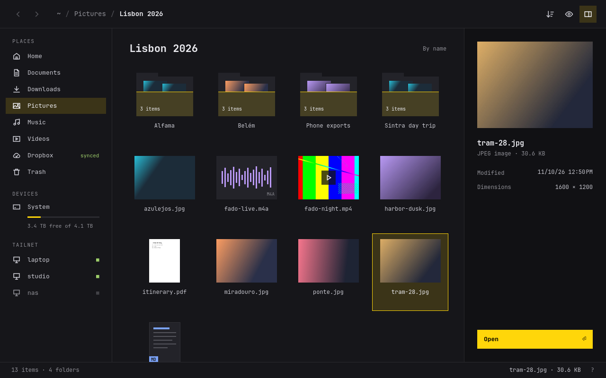

# Folio



Folio is Omarchy's file manager: one window for finding, previewing and opening your files. It follows the Omarchy theme and language live, works from the keyboard, and never crawls your home folder in the background. Thumbnails are made when a tile needs one and shared with other apps through the standard `~/.cache/thumbnails` cache.

- **Places**: Home and your standard folders, with Dropbox listed (and its sync status shown) once it's set up.
- **Devices**: the system drive and anything plugged in, with free space.
- **Tailnet**: the machines on your tailnet. Opening one mounts it over SFTP through GVfs and lands in the matching home folder.
- **Previews**: folders show the pictures inside them; photos, videos, PDFs and anything else with an installed thumbnailer show the real thing. The preview pane shows a larger look, the details, and the first lines of text files.
- **Show in folder**: Folio answers `org.freedesktop.FileManager1`, so other apps' "Show in folder" buttons open it with the file selected.

## Keyboard

| Key | Action |
| --- | --- |
| Arrow keys | Move the selection |
| Enter | Open |
| Backspace, Alt+Up | Go to the parent folder |
| Alt+Left / Alt+Right | Back / forward |
| Alt+Home | Go home |
| Space | Show or hide the preview |
| S | Sort by name or newest first |
| Ctrl+H | Show hidden files |
| F5 | Reload |
| ? | Show every shortcut |
| Q | Quit |

## Build

```sh
bin/build     # build/folio
bin/test      # the Qt Test suite, offscreen
bin/install   # build the package and install it with makepkg -fsi
```

Run `build/folio [folder or file]` to try it. A file opens its folder with the file selected.

## License

MIT.
